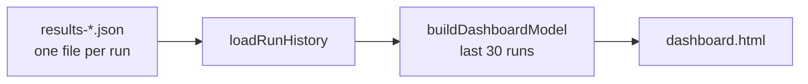

# Results Dashboard

The dashboard turns the results you've saved into a single HTML page: how the pass rate is trending, which test cases fail and when, and which assertions fail most often.


It is one self-contained file, with no server, scripts or fonts to load. Open it locally, upload it as a CI artifact, or publish it with GitHub Pages.

## Generating it

The dashboard is built from the `results-<timestamp>.json` files that `runTests` writes to `outputDir` when `saveResults` is on. Each file is one run.

**After every run:** set `dashboard: true` in the config, and `runTests` rewrites `dashboard.html` in `outputDir` after saving the results:

```yaml
saveResults: true
outputDir: ./results
dashboard: true
```

**From the command line**, for a folder of saved results:

```bash
npx agent-regression-testing dashboard ./agent-regression/results
```

| Option | Default | Description |
|--------|---------|-------------|
| `--out <file>` | `<dir>/dashboard.html` | Where to write the page |
| `--title <text>` | `Agent regression dashboard` | Page title |
| `--max-runs <n>` | `30` | How many of the most recent runs to show |

**From code**, with [`writeDashboard()`](/reference/api#writedashboard-outputdir-options) or, to control where the runs come from, [`generateDashboard()`](/reference/api#generatedashboard-runs-options).

## What it shows



| Section | What it tells you |
|---------|-------------------|
| **Pass rate, latest run** | The share of test cases that passed in the latest run, and the change since the previous run |
| **Tiles** | Average score, failing test cases, failed assertions, and test cases that passed last time but fail now |
| **Pass rate and average score over time** | One point per run. Hover for that run's numbers; **Show as table** lists every run |
| **Test cases by run** | One square per test case and run: ✓ passed, ✕ failed, · didn't run. Test cases failing in the latest run are listed first |
| **Most-failing assertions** | The ten assertions that failed in the most runs, with the test case they belong to |
| **Details** | Select a square to see that run's question, response, tool calls, and every assertion, criterion and keyword verdict. It opens on the first failing test case of the latest run |

The average score and the pass rate can disagree, and that's often the interesting part. In the screenshot, the average score stays at 100% because the judge is happy with every answer, while the pass rate drops because required assertions fail:


## Keeping history in CI

The dashboard covers whatever runs are in the folder, so in CI you need to keep the folder from one run to the next. With GitHub Actions, for example, restore it from the cache before the tests and upload the dashboard afterwards:

```yaml
- uses: actions/cache@v4
  with:
    path: agent-regression/results
    key: agent-regression-results-${{ github.run_id }}
    restore-keys: agent-regression-results-

- run: node agent-regression/run.mjs # config sets dashboard: true

- uses: actions/upload-artifact@v4
  if: always() # also when tests fail
  with:
    name: agent-regression-dashboard
    path: agent-regression/results/dashboard.html
```

Each run saves its cache under a new key, and the next run restores the most recent one, so the history keeps growing. Use `--max-runs` (or `maxRuns`) to control how much of it the page shows.
