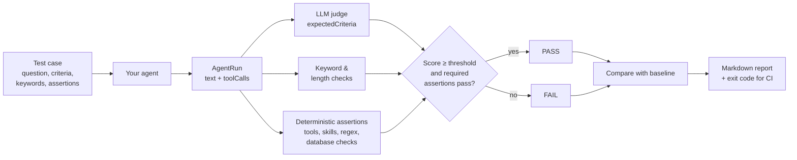

# Getting Started

## How it works



You provide the agent and the judge as plain functions. The library handles the rest: running each test case, scoring it, and comparing it with the baseline. See [Test Cases & Scoring](/guide/test-cases-and-scoring) for how each step decides.

## Installation

```bash
npm install agent-regression-testing
```

## 1. Initialize config files

```bash
npx agent-regression-testing init
```

This creates:

```
agent-regression/
  config.yml         # Scoring weights, thresholds, retry settings, file paths
  test-cases.json    # Example test case to customize
```

You can also specify a target directory:

```bash
npx agent-regression-testing init ./tests
```

## 2. Edit your test cases

Open `agent-regression/test-cases.json` and define your test cases:

```json
[
  {
    "id": "greeting",
    "category": "general",
    "question": "Hello, what can you do?",
    "expectedCriteria": [
      "Describes available capabilities",
      "Is polite and professional"
    ],
    "keywords": ["help"],
    "minResponseLength": 50
  }
]
```

## 3. Configure settings

Edit `agent-regression/config.yml` to tune scoring and behavior. Paths in the config are resolved relative to the config file's directory.

```yaml
scoringWeights:
  criteria: 0.6
  keywords: 0.3
  length: 0.1

passThreshold: 0.7
regressionThreshold: 0.2

retryConfig:
  maxRetries: 3
  initialDelay: 2000
  backoffMultiplier: 2
  retryOnStatusCodes:
    - 429

interCallDelay: 500

saveResults: true
outputDir: .
testCasesPath: ./test-cases.json
baselinePath: ./baseline.json
```

You can also provide a custom evaluation prompt template:

```yaml
evaluationPromptTemplate: |
  You are an AI response evaluator.

  Question: {{question}}
  Response: {{response}}
  Criterion: {{criterion}}

  MET: [YES/NO]
  REASONING: [1-2 sentences]
```

## 4. Write your test runner

`loadConfig()` reads the YAML config and automatically loads test cases and baseline data from the paths specified in the config file. You only need to inject your agent and evaluation LLM:

```typescript
import {
  loadConfig,
  runTests,
  type RunnerConfig,
} from "agent-regression-testing";

const fileConfig = await loadConfig("./agent-regression/config.yml");
// fileConfig.testCases  — loaded from testCasesPath
// fileConfig.baseline   — loaded from baselinePath (undefined if not found)

const config: RunnerConfig = {
  ...fileConfig,
  testCases: fileConfig.testCases!,
  agent: async (question) => {
    // Wire your agent here
    const response = await myAgent.generate(question);
    return response.text;
  },
  evaluationLLM: async (prompt) => {
    // Wire your evaluation LLM here
    const result = await generateText({ model: myModel, prompt });
    return result.text;
  },
};

const { report, exitCode } = await runTests(config);
console.log(report);
process.exit(exitCode);
```

## 5. Run it

Save the runner from step 4 as `agent-regression/run.ts` and run it with a TypeScript runner such as [tsx](https://tsx.is), or write it in plain JavaScript and use `node`:

```bash
npx tsx agent-regression/run.ts
```

Each test case is logged as it runs, followed by the baseline comparison:


The exit code is `1` when any test case fails or regresses, so the script can gate CI directly. The Markdown report saved next to the results explains every verdict. See [Run output](/guide/test-cases-and-scoring#run-output).

## 6. Track runs over time

Add `dashboard: true` to the config, and every run also rewrites a `dashboard.html` next to the results, covering every run saved there. See [Results Dashboard](/guide/dashboard).
