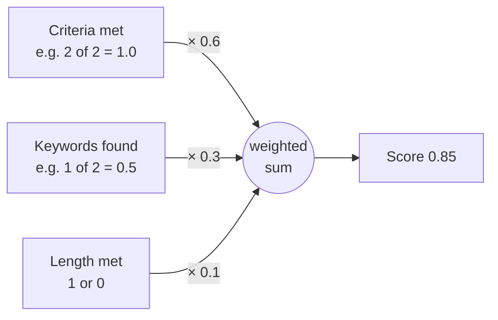
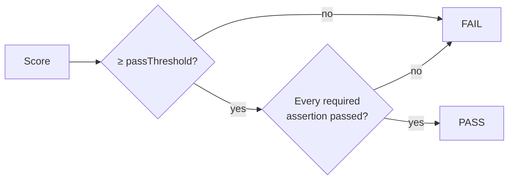
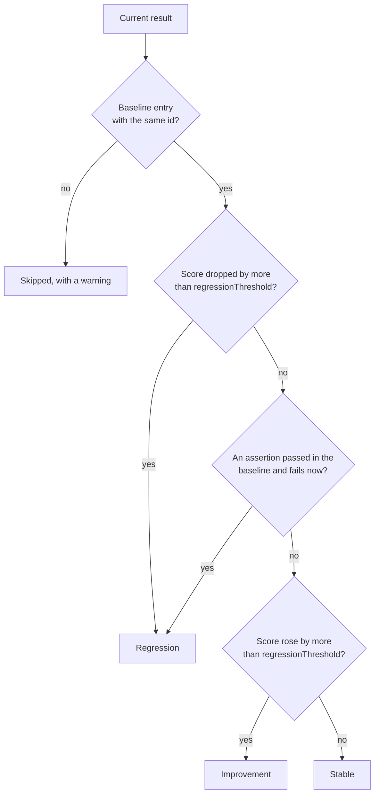

# Test Cases & Scoring

## Test case fields

Test cases live in the JSON file named by `testCasesPath`. Only `id` and `question` are required.

| Field | Type | Default | Description |
|-------|------|---------|-------------|
| `id` | `string` | — | Unique identifier, used to match results against the baseline |
| `question` | `string` | — | Sent to your agent |
| `category` | `string` | `"general"` | Free-form grouping, shown in the run log |
| `expectedCriteria` | `string[]` | `[]` | Statements the [judge](/guide/judges) checks the response against |
| `keywords` | `string[]` | `[]` | Substrings the response should contain (case-sensitive) |
| `minResponseLength` | `number` | `0` | Minimum response length in characters |
| `assertions` | `Assertion[]` | — | [Deterministic assertions](/guide/assertions) on what the agent did |

`loadConfig()` validates the file and fills in the defaults. Test cases with no `expectedCriteria` never call the judge.

## How a test case is scored

Each test case gets a score from 0 to 1, a weighted sum of three components:

| Component | Score | Default weight |
|-----------|-------|----------------|
| Criteria | Fraction of `expectedCriteria` the judge marked as met | `0.6` |
| Keywords | Fraction of `keywords` found in the response | `0.3` |
| Length | `1` if the response is at least `minResponseLength` characters, else `0` | `0.1` |



An empty `expectedCriteria` or `keywords` list counts as fully met. Change the weights with `scoringWeights` in the config.

When a test case has assertions with `required: false`, their pass rate becomes a fourth component, weighted by `scoringWeights.assertions` (default `0.3`), and all weights are normalized to sum to one. See [Required vs. scored assertions](/guide/assertions#required-vs-scored-assertions).

A test case **passes** when its score is at least `passThreshold` (default `0.7`) and every required assertion passed:



A required assertion is a gate, not a weight: a test case with a perfect judge score still fails if the agent called the wrong tool.

## Baselines and regressions

A baseline is a saved set of results to compare later runs against. Save one from a run you're happy with:

```typescript
import { backupBaseline, runTests, saveBaseline } from "agent-regression-testing";

const { results } = await runTests(config);
await backupBaseline("./agent-regression/baseline.json"); // keep the previous one
await saveBaseline("./agent-regression/baseline.json", results);
```

When `baselinePath` points at an existing file, `loadConfig()` loads it and `runTests` compares each test case with its baseline entry, matched by `id`. A test case counts as a **regression** when:

- its score dropped by more than `regressionThreshold` (default `0.2`), or
- an assertion that passed in the baseline now fails.



A score rise of more than `regressionThreshold` is reported as an improvement. Test cases missing from the baseline are skipped with a warning.

## Run output

`runTests` returns `{ results, report, exitCode }`:

- `results`: one `EvaluationResult` per test case
- `report`: a Markdown summary with per-test details and the baseline comparison
- `exitCode`: `1` if any test case failed or regressed, otherwise `0`, so you can pass it to `process.exit()` in CI

An excerpt from a report, for a test case where the judge was satisfied but the agent refunded the wrong order:


When `outputDir` is set and `saveResults` isn't `false`, the results and the report are also written to `results-<timestamp>.json` and `results-<timestamp>.md` in `outputDir`.
