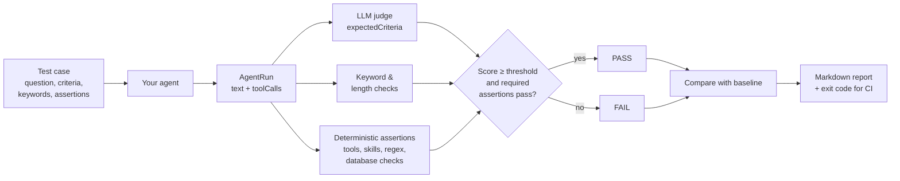

In this demo, the agent answers every question politely, so the LLM judge passes all three test cases. But it refunded order #456 instead of #123. The `toolCalled` assertion and the database check catch that, and the baseline comparison flags it as a regression.

## How it works

